<!-- PAGE_ID: skills-registry-demo_03_plugins -->

📚 Relevant source files

The following files were used as context for generating this wiki page:

- [marketplace.json:1-33](https://github.com/port-gh-app-dev/skills-registry-demo/blob/4140e5ec64a5bdbd04a267fd6b8aeb022f52fb33/.claude-plugin/marketplace.json#L1-L33)
- [plugin.json:1-4](https://github.com/port-gh-app-dev/skills-registry-demo/blob/4140e5ec64a5bdbd04a267fd6b8aeb022f52fb33/plugins/port-ops-toolkit/.claude-plugin/plugin.json#L1-L4)
- [validate-plugin-symlinks.yml:1-66](https://github.com/port-gh-app-dev/skills-registry-demo/blob/4140e5ec64a5bdbd04a267fd6b8aeb022f52fb33/.github/workflows/validate-plugin-symlinks.yml#L1-L66)

# Plugins and Marketplace

> **Related Pages**: [[GitHub Actions Automation|04_automation.md]]

---

<!-- BEGIN:AUTOGEN skills-registry-demo_03_plugins_marketplace -->
## Marketplace Manifest

`.claude-plugin/marketplace.json` names the marketplace `skills-registry-demo` and lists five plugins, each with a `source` path under `./plugins/` ([marketplace.json:2-31](https://github.com/port-gh-app-dev/skills-registry-demo/blob/4140e5ec64a5bdbd04a267fd6b8aeb022f52fb33/.claude-plugin/marketplace.json#L2-L31)).

| Plugin | Description |
|--------|-------------|
| `cursor-productivity-toolkit` | Exploring, reviewing and fixing code in parallel ([marketplace.json:8-11](https://github.com/port-gh-app-dev/skills-registry-demo/blob/4140e5ec64a5bdbd04a267fd6b8aeb022f52fb33/.claude-plugin/marketplace.json#L8-L11)) |
| `code-quality-toolkit` | Code review, debugging, test writing ([marketplace.json:13-16](https://github.com/port-gh-app-dev/skills-registry-demo/blob/4140e5ec64a5bdbd04a267fd6b8aeb022f52fb33/.claude-plugin/marketplace.json#L13-L16)) |
| `frontend-toolkit` | Frontend UI and product instrumentation ([marketplace.json:18-21](https://github.com/port-gh-app-dev/skills-registry-demo/blob/4140e5ec64a5bdbd04a267fd6b8aeb022f52fb33/.claude-plugin/marketplace.json#L18-L21)) |
| `infrastructure-toolkit` | Containers, CI, PRs, incidents ([marketplace.json:23-26](https://github.com/port-gh-app-dev/skills-registry-demo/blob/4140e5ec64a5bdbd04a267fd6b8aeb022f52fb33/.claude-plugin/marketplace.json#L23-L26)) |
| `port-ops-toolkit` | Port incident triage and service health ([marketplace.json:28-31](https://github.com/port-gh-app-dev/skills-registry-demo/blob/4140e5ec64a5bdbd04a267fd6b8aeb022f52fb33/.claude-plugin/marketplace.json#L28-L31)) |

Each plugin carries a small `plugin.json` with `name`, `description` and `version` (all `1.0.0` in the files read) ([plugin.json:1-4](https://github.com/port-gh-app-dev/skills-registry-demo/blob/4140e5ec64a5bdbd04a267fd6b8aeb022f52fb33/plugins/port-ops-toolkit/.claude-plugin/plugin.json#L1-L4)). Most plugins have both `.claude-plugin/` and `.cursor-plugin/` copies. `cursor-productivity-toolkit` has only `.cursor-plugin/` ([plugin.json:1-4](https://github.com/port-gh-app-dev/skills-registry-demo/blob/4140e5ec64a5bdbd04a267fd6b8aeb022f52fb33/plugins/cursor-productivity-toolkit/.cursor-plugin/plugin.json#L1-L4)), though it is still listed in the marketplace.

Sources: [marketplace.json:1-33](https://github.com/port-gh-app-dev/skills-registry-demo/blob/4140e5ec64a5bdbd04a267fd6b8aeb022f52fb33/.claude-plugin/marketplace.json#L1-L33)
<!-- END:AUTOGEN skills-registry-demo_03_plugins_marketplace -->

---

<!-- BEGIN:AUTOGEN skills-registry-demo_03_plugins_structure -->
## Plugin Structure and Symlinks

A plugin does not copy skills. Each entry under `plugins/<plugin>/skills/` must be a symlink to the real `skills/<category>/<slug>` directory ([validate-plugin-symlinks.yml:32-36](https://github.com/port-gh-app-dev/skills-registry-demo/blob/4140e5ec64a5bdbd04a267fd6b8aeb022f52fb33/.github/workflows/validate-plugin-symlinks.yml#L32-L36)). The target must start with `../../../skills/` ([validate-plugin-symlinks.yml:45-52](https://github.com/port-gh-app-dev/skills-registry-demo/blob/4140e5ec64a5bdbd04a267fd6b8aeb022f52fb33/.github/workflows/validate-plugin-symlinks.yml#L45-L52)) and contain a `SKILL.md` ([validate-plugin-symlinks.yml:54-57](https://github.com/port-gh-app-dev/skills-registry-demo/blob/4140e5ec64a5bdbd04a267fd6b8aeb022f52fb33/.github/workflows/validate-plugin-symlinks.yml#L54-L57)).

Observed on disk (`ls -l`), the same skill can be bundled into more than one plugin: `writing-tests` appears in both `code-quality-toolkit` and `infrastructure-toolkit`. `port-ops-toolkit` also bundles `adding-auth` from `utilities`.

Sources: [validate-plugin-symlinks.yml:15-57](https://github.com/port-gh-app-dev/skills-registry-demo/blob/4140e5ec64a5bdbd04a267fd6b8aeb022f52fb33/.github/workflows/validate-plugin-symlinks.yml#L15-L57)
<!-- END:AUTOGEN skills-registry-demo_03_plugins_structure -->

---
