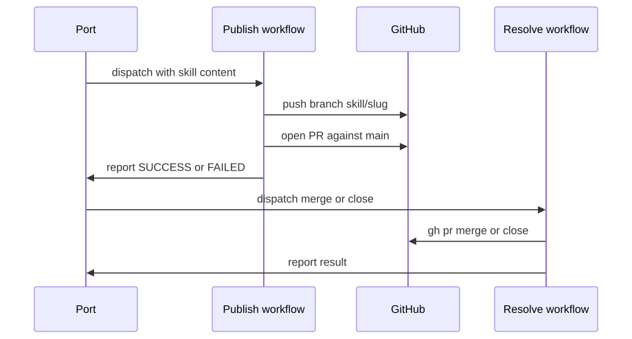

<!-- PAGE_ID: skills-registry-demo_04_automation -->

📚 Relevant source files

The following files were used as context for generating this wiki page:

- [publish-skill.yml:1-89](https://github.com/port-gh-app-dev/skills-registry-demo/blob/4140e5ec64a5bdbd04a267fd6b8aeb022f52fb33/.github/workflows/publish-skill.yml#L1-L89)
- [resolve-skill-pr.yml:1-70](https://github.com/port-gh-app-dev/skills-registry-demo/blob/4140e5ec64a5bdbd04a267fd6b8aeb022f52fb33/.github/workflows/resolve-skill-pr.yml#L1-L70)
- [apply-bundling-suggestion.yml:1-185](https://github.com/port-gh-app-dev/skills-registry-demo/blob/4140e5ec64a5bdbd04a267fd6b8aeb022f52fb33/.github/workflows/apply-bundling-suggestion.yml#L1-L185)
- [validate-plugin-symlinks.yml:1-66](https://github.com/port-gh-app-dev/skills-registry-demo/blob/4140e5ec64a5bdbd04a267fd6b8aeb022f52fb33/.github/workflows/validate-plugin-symlinks.yml#L1-L66)
- [sync-plugin-metadata.yml:1-27](https://github.com/port-gh-app-dev/skills-registry-demo/blob/4140e5ec64a5bdbd04a267fd6b8aeb022f52fb33/.github/workflows/sync-plugin-metadata.yml#L1-L27)

# GitHub Actions Automation

> **Related Pages**: [[Port Metadata Sync|05_port-sync.md]]

---

<!-- BEGIN:AUTOGEN skills-registry-demo_04_automation_overview -->
## Workflow Overview

Five workflows live in `.github/workflows/`. Three are `workflow_dispatch` jobs triggered from Port and they report back to Port using `PORT_CLIENT_ID` and `PORT_CLIENT_SECRET` secrets.

| Workflow | Trigger | Purpose |
|----------|---------|---------|
| Publish skill (from Port) | `workflow_dispatch` ([publish-skill.yml:3-21](https://github.com/port-gh-app-dev/skills-registry-demo/blob/4140e5ec64a5bdbd04a267fd6b8aeb022f52fb33/.github/workflows/publish-skill.yml#L3-L21)) | Writes a SKILL.md on a branch and opens a PR |
| Resolve skill PR (from Port) | `workflow_dispatch` ([resolve-skill-pr.yml:3-20](https://github.com/port-gh-app-dev/skills-registry-demo/blob/4140e5ec64a5bdbd04a267fd6b8aeb022f52fb33/.github/workflows/resolve-skill-pr.yml#L3-L20)) | Merges or closes a PR |
| Apply bundling suggestion (from Port) | `workflow_dispatch` ([apply-bundling-suggestion.yml:3-21](https://github.com/port-gh-app-dev/skills-registry-demo/blob/4140e5ec64a5bdbd04a267fd6b8aeb022f52fb33/.github/workflows/apply-bundling-suggestion.yml#L3-L21)) | Symlinks a skill into a plugin, opens, and merges a PR |
| Validate plugin symlinks | `pull_request` on `plugins/**`, `skills/**` ([validate-plugin-symlinks.yml:3-7](https://github.com/port-gh-app-dev/skills-registry-demo/blob/4140e5ec64a5bdbd04a267fd6b8aeb022f52fb33/.github/workflows/validate-plugin-symlinks.yml#L3-L7)) | Checks the symlink rules |
| Sync plugin metadata to Port | push to `main` on skill/plugin paths, or manual ([sync-plugin-metadata.yml:3-10](https://github.com/port-gh-app-dev/skills-registry-demo/blob/4140e5ec64a5bdbd04a267fd6b8aeb022f52fb33/.github/workflows/sync-plugin-metadata.yml#L3-L10)) | Runs the sync script |

PR creation and merging use a `GH_PAT` secret rather than the default token ([publish-skill.yml:51-62](https://github.com/port-gh-app-dev/skills-registry-demo/blob/4140e5ec64a5bdbd04a267fd6b8aeb022f52fb33/.github/workflows/publish-skill.yml#L51-L62)). Commits are authored as `port-skills-bot` ([publish-skill.yml:44-45](https://github.com/port-gh-app-dev/skills-registry-demo/blob/4140e5ec64a5bdbd04a267fd6b8aeb022f52fb33/.github/workflows/publish-skill.yml#L44-L45)).

Sources: [publish-skill.yml:1-21](https://github.com/port-gh-app-dev/skills-registry-demo/blob/4140e5ec64a5bdbd04a267fd6b8aeb022f52fb33/.github/workflows/publish-skill.yml#L1-L21), [sync-plugin-metadata.yml:1-27](https://github.com/port-gh-app-dev/skills-registry-demo/blob/4140e5ec64a5bdbd04a267fd6b8aeb022f52fb33/.github/workflows/sync-plugin-metadata.yml#L1-L27)
<!-- END:AUTOGEN skills-registry-demo_04_automation_overview -->

---

<!-- BEGIN:AUTOGEN skills-registry-demo_04_automation_publish -->
## Publishing and Resolving Skill PRs

The publish workflow takes `skill_name`, `target_path`, `skill_content` and `node_run_id` ([publish-skill.yml:4-21](https://github.com/port-gh-app-dev/skills-registry-demo/blob/4140e5ec64a5bdbd04a267fd6b8aeb022f52fb33/.github/workflows/publish-skill.yml#L4-L21)). It derives a branch `skill/<slug>` from the parent directory name, writes the content with `printf '%s'`, commits and force-pushes ([publish-skill.yml:32-49](https://github.com/port-gh-app-dev/skills-registry-demo/blob/4140e5ec64a5bdbd04a267fd6b8aeb022f52fb33/.github/workflows/publish-skill.yml#L32-L49)). It then opens a PR against `main` ([publish-skill.yml:51-62](https://github.com/port-gh-app-dev/skills-registry-demo/blob/4140e5ec64a5bdbd04a267fd6b8aeb022f52fb33/.github/workflows/publish-skill.yml#L51-L62)). A final `if: always()` step PATCHes the Port workflow node run with `COMPLETED` and `SUCCESS` or `FAILED` ([publish-skill.yml:64-89](https://github.com/port-gh-app-dev/skills-registry-demo/blob/4140e5ec64a5bdbd04a267fd6b8aeb022f52fb33/.github/workflows/publish-skill.yml#L64-L89)).

The resolve workflow takes `action` (`merge` or `close`), `pr_number` and `node_run_id`, runs `gh pr merge --merge` or `gh pr close`, deleting the branch either way, and reports back ([resolve-skill-pr.yml:3-20](https://github.com/port-gh-app-dev/skills-registry-demo/blob/4140e5ec64a5bdbd04a267fd6b8aeb022f52fb33/.github/workflows/resolve-skill-pr.yml#L3-L20), [resolve-skill-pr.yml:31-45](https://github.com/port-gh-app-dev/skills-registry-demo/blob/4140e5ec64a5bdbd04a267fd6b8aeb022f52fb33/.github/workflows/resolve-skill-pr.yml#L31-L45)).

Security note: `skill_name` is interpolated directly into shell `run:` scripts via `${{ inputs.skill_name }}` in the commit message ([publish-skill.yml:47](https://github.com/port-gh-app-dev/skills-registry-demo/blob/4140e5ec64a5bdbd04a267fd6b8aeb022f52fb33/.github/workflows/publish-skill.yml#L47)) and the PR title ([publish-skill.yml:57-58](https://github.com/port-gh-app-dev/skills-registry-demo/blob/4140e5ec64a5bdbd04a267fd6b8aeb022f52fb33/.github/workflows/publish-skill.yml#L57-L58)), while `target_path` and `skill_content` are passed through `env` ([publish-skill.yml:34-36](https://github.com/port-gh-app-dev/skills-registry-demo/blob/4140e5ec64a5bdbd04a267fd6b8aeb022f52fb33/.github/workflows/publish-skill.yml#L34-L36)). Since dispatch inputs come from an external system, this is an injection surface; moving them to `env` variables would harden it.

Sources: [publish-skill.yml:1-89](https://github.com/port-gh-app-dev/skills-registry-demo/blob/4140e5ec64a5bdbd04a267fd6b8aeb022f52fb33/.github/workflows/publish-skill.yml#L1-L89), [resolve-skill-pr.yml:1-70](https://github.com/port-gh-app-dev/skills-registry-demo/blob/4140e5ec64a5bdbd04a267fd6b8aeb022f52fb33/.github/workflows/resolve-skill-pr.yml#L1-L70)
<!-- END:AUTOGEN skills-registry-demo_04_automation_publish -->

---

<!-- BEGIN:AUTOGEN skills-registry-demo_04_automation_bundling -->
## Applying Bundling Suggestions

Inputs are `suggestion_identifier`, `skill_path`, `plugin_folder` and `node_run_id` ([apply-bundling-suggestion.yml:3-21](https://github.com/port-gh-app-dev/skills-registry-demo/blob/4140e5ec64a5bdbd04a267fd6b8aeb022f52fb33/.github/workflows/apply-bundling-suggestion.yml#L3-L21)). Steps:

1. Validate that the plugin folder and SKILL.md exist and the skill is not already bundled ([apply-bundling-suggestion.yml:37-55](https://github.com/port-gh-app-dev/skills-registry-demo/blob/4140e5ec64a5bdbd04a267fd6b8aeb022f52fb33/.github/workflows/apply-bundling-suggestion.yml#L37-L55)).
2. Create branch `bundle/<plugin>-<slug>`, add a `../../../<skill dir>` symlink, push and open a PR ([apply-bundling-suggestion.yml:63-86](https://github.com/port-gh-app-dev/skills-registry-demo/blob/4140e5ec64a5bdbd04a267fd6b8aeb022f52fb33/.github/workflows/apply-bundling-suggestion.yml#L63-L86)).
3. Mark the `skill_bundling_suggestion` entity `accepted` in Port ([apply-bundling-suggestion.yml:103-118](https://github.com/port-gh-app-dev/skills-registry-demo/blob/4140e5ec64a5bdbd04a267fd6b8aeb022f52fb33/.github/workflows/apply-bundling-suggestion.yml#L103-L118)).
4. Wait for PR checks; "no checks reported" counts as success ([apply-bundling-suggestion.yml:120-139](https://github.com/port-gh-app-dev/skills-registry-demo/blob/4140e5ec64a5bdbd04a267fd6b8aeb022f52fb33/.github/workflows/apply-bundling-suggestion.yml#L120-L139)).
5. Merge, delete the branch and mark the entity `applied` ([apply-bundling-suggestion.yml:141-156](https://github.com/port-gh-app-dev/skills-registry-demo/blob/4140e5ec64a5bdbd04a267fd6b8aeb022f52fb33/.github/workflows/apply-bundling-suggestion.yml#L141-L156)).
6. Report overall success only if every step succeeded ([apply-bundling-suggestion.yml:158-185](https://github.com/port-gh-app-dev/skills-registry-demo/blob/4140e5ec64a5bdbd04a267fd6b8aeb022f52fb33/.github/workflows/apply-bundling-suggestion.yml#L158-L185)).

Sources: [apply-bundling-suggestion.yml:1-185](https://github.com/port-gh-app-dev/skills-registry-demo/blob/4140e5ec64a5bdbd04a267fd6b8aeb022f52fb33/.github/workflows/apply-bundling-suggestion.yml#L1-L185)
<!-- END:AUTOGEN skills-registry-demo_04_automation_bundling -->

---

<!-- BEGIN:AUTOGEN skills-registry-demo_04_automation_validation -->
## Symlink Validation

On pull requests touching `plugins/**` or `skills/**`, the validator loops over every `plugins/*/skills/*` entry ([validate-plugin-symlinks.yml:3-7](https://github.com/port-gh-app-dev/skills-registry-demo/blob/4140e5ec64a5bdbd04a267fd6b8aeb022f52fb33/.github/workflows/validate-plugin-symlinks.yml#L3-L7), [validate-plugin-symlinks.yml:25-30](https://github.com/port-gh-app-dev/skills-registry-demo/blob/4140e5ec64a5bdbd04a267fd6b8aeb022f52fb33/.github/workflows/validate-plugin-symlinks.yml#L25-L30)). It emits an error for each of: not a symlink, broken symlink, target outside `../../../skills/*`, or missing `SKILL.md`, and fails the job if any error was counted ([validate-plugin-symlinks.yml:32-66](https://github.com/port-gh-app-dev/skills-registry-demo/blob/4140e5ec64a5bdbd04a267fd6b8aeb022f52fb33/.github/workflows/validate-plugin-symlinks.yml#L32-L66)).

Sources: [validate-plugin-symlinks.yml:1-66](https://github.com/port-gh-app-dev/skills-registry-demo/blob/4140e5ec64a5bdbd04a267fd6b8aeb022f52fb33/.github/workflows/validate-plugin-symlinks.yml#L1-L66)
<!-- END:AUTOGEN skills-registry-demo_04_automation_validation -->

---
