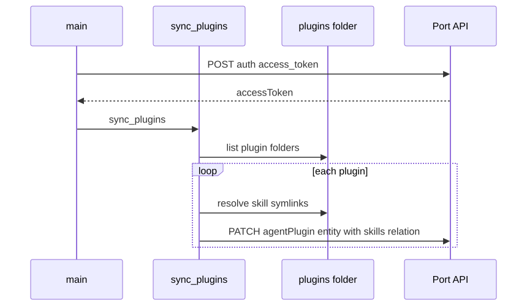

<!-- PAGE_ID: skills-registry-demo_05_port-sync -->

📚 Relevant source files

The following files were used as context for generating this wiki page:

- [sync_plugin_metadata.py:1-147](https://github.com/port-gh-app-dev/skills-registry-demo/blob/4140e5ec64a5bdbd04a267fd6b8aeb022f52fb33/scripts/sync_plugin_metadata.py#L1-L147)
- [sync-plugin-metadata.yml:1-27](https://github.com/port-gh-app-dev/skills-registry-demo/blob/4140e5ec64a5bdbd04a267fd6b8aeb022f52fb33/.github/workflows/sync-plugin-metadata.yml#L1-L27)

# Port Metadata Sync

> **Related Pages**: [[Plugins and Marketplace|03_plugins.md]]

---

<!-- BEGIN:AUTOGEN skills-registry-demo_05_port-sync_purpose -->
## Purpose and Configuration

Port's GitHub Ocean integration cannot aggregate a folder of symlinks into one relation, so this script fills each plugin's `skills` relation on the Port `agentPlugin` entity from the real symlinks under `plugins/<name>/skills/` ([sync_plugin_metadata.py:2-8](https://github.com/port-gh-app-dev/skills-registry-demo/blob/4140e5ec64a5bdbd04a267fd6b8aeb022f52fb33/scripts/sync_plugin_metadata.py#L2-L8)). It uses only the standard library ([sync_plugin_metadata.py:21-27](https://github.com/port-gh-app-dev/skills-registry-demo/blob/4140e5ec64a5bdbd04a267fd6b8aeb022f52fb33/scripts/sync_plugin_metadata.py#L21-L27)).

| Variable | Use |
|----------|-----|
| `PORT_CLIENT_ID`, `PORT_CLIENT_SECRET` | Port API credentials, required ([sync_plugin_metadata.py:135-136](https://github.com/port-gh-app-dev/skills-registry-demo/blob/4140e5ec64a5bdbd04a267fd6b8aeb022f52fb33/scripts/sync_plugin_metadata.py#L135-L136)) |
| `GITHUB_TOKEN`, `GITHUB_REPOSITORY` | Required by `main()` ([sync_plugin_metadata.py:137-138](https://github.com/port-gh-app-dev/skills-registry-demo/blob/4140e5ec64a5bdbd04a267fd6b8aeb022f52fb33/scripts/sync_plugin_metadata.py#L137-L138)) |
| `PORT_API_URL` | Optional, defaults to `https://api.port.io` ([sync_plugin_metadata.py:29](https://github.com/port-gh-app-dev/skills-registry-demo/blob/4140e5ec64a5bdbd04a267fd6b8aeb022f52fb33/scripts/sync_plugin_metadata.py#L29)) |

The workflow runs on pushes to `main` that touch `skills/**/SKILL.md`, `plugins/**/plugin.json` or `plugins/**/skills/**`, and can be dispatched manually. It uses Python 3.12 ([sync-plugin-metadata.yml:3-20](https://github.com/port-gh-app-dev/skills-registry-demo/blob/4140e5ec64a5bdbd04a267fd6b8aeb022f52fb33/.github/workflows/sync-plugin-metadata.yml#L3-L20)).

`sync_skills()` is disabled: its call in `main()` is commented out because skill entities no longer carry `lastEditor` / `lastEditedAt` ([sync_plugin_metadata.py:10-11](https://github.com/port-gh-app-dev/skills-registry-demo/blob/4140e5ec64a5bdbd04a267fd6b8aeb022f52fb33/scripts/sync_plugin_metadata.py#L10-L11), [sync_plugin_metadata.py:142-143](https://github.com/port-gh-app-dev/skills-registry-demo/blob/4140e5ec64a5bdbd04a267fd6b8aeb022f52fb33/scripts/sync_plugin_metadata.py#L142-L143)). Note that `GITHUB_TOKEN` is still required even though only the disabled path uses it.

Sources: [sync_plugin_metadata.py:1-30](https://github.com/port-gh-app-dev/skills-registry-demo/blob/4140e5ec64a5bdbd04a267fd6b8aeb022f52fb33/scripts/sync_plugin_metadata.py#L1-L30), [sync-plugin-metadata.yml:1-27](https://github.com/port-gh-app-dev/skills-registry-demo/blob/4140e5ec64a5bdbd04a267fd6b8aeb022f52fb33/.github/workflows/sync-plugin-metadata.yml#L1-L27)
<!-- END:AUTOGEN skills-registry-demo_05_port-sync_purpose -->

---

<!-- BEGIN:AUTOGEN skills-registry-demo_05_port-sync_flow -->
## Sync Flow

`main()` exchanges the client credentials for an access token, then calls `sync_plugins` ([sync_plugin_metadata.py:134-143](https://github.com/port-gh-app-dev/skills-registry-demo/blob/4140e5ec64a5bdbd04a267fd6b8aeb022f52fb33/scripts/sync_plugin_metadata.py#L134-L143)). `sync_plugins` lists the `plugins/*/` folders, resolves each plugin's symlinked skills, and PATCHes the `agentPlugin` entity `<repo>/<plugin>` with a `skills` relation ([sync_plugin_metadata.py:116-131](https://github.com/port-gh-app-dev/skills-registry-demo/blob/4140e5ec64a5bdbd04a267fd6b8aeb022f52fb33/scripts/sync_plugin_metadata.py#L116-L131)). Skill identifiers have the form `<repo>/skills/<category>/<slug>/SKILL.md`, computed from each symlink's real path ([sync_plugin_metadata.py:85-97](https://github.com/port-gh-app-dev/skills-registry-demo/blob/4140e5ec64a5bdbd04a267fd6b8aeb022f52fb33/scripts/sync_plugin_metadata.py#L85-L97)).

Sources: [sync_plugin_metadata.py:48-54](https://github.com/port-gh-app-dev/skills-registry-demo/blob/4140e5ec64a5bdbd04a267fd6b8aeb022f52fb33/scripts/sync_plugin_metadata.py#L48-L54), [sync_plugin_metadata.py:116-143](https://github.com/port-gh-app-dev/skills-registry-demo/blob/4140e5ec64a5bdbd04a267fd6b8aeb022f52fb33/scripts/sync_plugin_metadata.py#L116-L143)
<!-- END:AUTOGEN skills-registry-demo_05_port-sync_flow -->

---

<!-- BEGIN:AUTOGEN skills-registry-demo_05_port-sync_api -->
## Function Reference

| Function | Description |
|----------|-------------|
| `http_json(method, url, headers, body)` | JSON request helper that logs HTTP errors to stderr and re-raises ([sync_plugin_metadata.py:33-45](https://github.com/port-gh-app-dev/skills-registry-demo/blob/4140e5ec64a5bdbd04a267fd6b8aeb022f52fb33/scripts/sync_plugin_metadata.py#L33-L45)) |
| `get_port_token(id, secret)` | Obtains a Port access token ([sync_plugin_metadata.py:48-54](https://github.com/port-gh-app-dev/skills-registry-demo/blob/4140e5ec64a5bdbd04a267fd6b8aeb022f52fb33/scripts/sync_plugin_metadata.py#L48-L54)) |
| `get_last_commit_for_path(repo, path, token)` | Fetches the latest commit's author and date from the GitHub API; used only by the disabled `sync_skills` ([sync_plugin_metadata.py:57-72](https://github.com/port-gh-app-dev/skills-registry-demo/blob/4140e5ec64a5bdbd04a267fd6b8aeb022f52fb33/scripts/sync_plugin_metadata.py#L57-L72)) |
| `upsert_entity(...)` | PATCHes `/v1/blueprints/<bp>/entities/<id>` with properties and optional relations ([sync_plugin_metadata.py:75-82](https://github.com/port-gh-app-dev/skills-registry-demo/blob/4140e5ec64a5bdbd04a267fd6b8aeb022f52fb33/scripts/sync_plugin_metadata.py#L75-L82)) |
| `get_plugin_skill_identifiers(repo, plugin)` | Returns identifiers for symlinked skills, skipping non-symlinks ([sync_plugin_metadata.py:85-97](https://github.com/port-gh-app-dev/skills-registry-demo/blob/4140e5ec64a5bdbd04a267fd6b8aeb022f52fb33/scripts/sync_plugin_metadata.py#L85-L97)) |
| `sync_skills(...)` | Disabled per-skill editor sync ([sync_plugin_metadata.py:100-113](https://github.com/port-gh-app-dev/skills-registry-demo/blob/4140e5ec64a5bdbd04a267fd6b8aeb022f52fb33/scripts/sync_plugin_metadata.py#L100-L113)) |
| `sync_plugins(...)` | Active plugin-to-skills relation sync ([sync_plugin_metadata.py:116-131](https://github.com/port-gh-app-dev/skills-registry-demo/blob/4140e5ec64a5bdbd04a267fd6b8aeb022f52fb33/scripts/sync_plugin_metadata.py#L116-L131)) |

Because `upsert_entity` uses PATCH, entities must already exist in Port (ingested by the integration); the script does not create them. This is an inference from the use of PATCH, not stated in the source.

Sources: [sync_plugin_metadata.py:33-131](https://github.com/port-gh-app-dev/skills-registry-demo/blob/4140e5ec64a5bdbd04a267fd6b8aeb022f52fb33/scripts/sync_plugin_metadata.py#L33-L131)
<!-- END:AUTOGEN skills-registry-demo_05_port-sync_api -->

---
