<!-- PAGE_ID: skills-registry-demo_01_overview -->

📚 Relevant source files

The following files were used as context for generating this wiki page:

- [README.md:1-212](https://github.com/port-gh-app-dev/skills-registry-demo/blob/4140e5ec64a5bdbd04a267fd6b8aeb022f52fb33/README.md#L1-L212)
- [CONTRIBUTING.md:1-24](https://github.com/port-gh-app-dev/skills-registry-demo/blob/4140e5ec64a5bdbd04a267fd6b8aeb022f52fb33/CONTRIBUTING.md#L1-L24)

# Overview

> **Related Pages**: [[Skills Catalog|02_skills-catalog.md]]

---

<!-- BEGIN:AUTOGEN skills-registry-demo_01_overview_introduction -->
## Introduction

Skills Registry Demo is a curated collection of Cursor Agent Skills, organized to demonstrate Port's skills registry capabilities ([README.md:3](https://github.com/port-gh-app-dev/skills-registry-demo/blob/4140e5ec64a5bdbd04a267fd6b8aeb022f52fb33/README.md#L3)). The README states it contains 65+ skills grouped by category ([README.md:5](https://github.com/port-gh-app-dev/skills-registry-demo/blob/4140e5ec64a5bdbd04a267fd6b8aeb022f52fb33/README.md#L5)).

A skill is installed by copying its folder into `~/.cursor/skills/` (personal) or `.cursor/skills/` (project) ([README.md:9-14](https://github.com/port-gh-app-dev/skills-registry-demo/blob/4140e5ec64a5bdbd04a267fd6b8aeb022f52fb33/README.md#L9-L14)).

The registry is designed to work with Port's service catalog: each SKILL.md is ingested as an entity, ownership is tracked, scorecards check quality, and installation is offered as a self-service action ([README.md:169-176](https://github.com/port-gh-app-dev/skills-registry-demo/blob/4140e5ec64a5bdbd04a267fd6b8aeb022f52fb33/README.md#L169-L176)).

Sources: [README.md:1-14](https://github.com/port-gh-app-dev/skills-registry-demo/blob/4140e5ec64a5bdbd04a267fd6b8aeb022f52fb33/README.md#L1-L14), [README.md:169-176](https://github.com/port-gh-app-dev/skills-registry-demo/blob/4140e5ec64a5bdbd04a267fd6b8aeb022f52fb33/README.md#L169-L176)
<!-- END:AUTOGEN skills-registry-demo_01_overview_introduction -->

---

<!-- BEGIN:AUTOGEN skills-registry-demo_01_overview_layout -->
## Repository Layout

The repository has no application code. It consists of skill content, plugin manifests, one Python sync script and GitHub Actions workflows.

| Path | Role |
|------|------|
| `skills/<category>/<skill>/SKILL.md` | The real skill content ([README.md:131-144](https://github.com/port-gh-app-dev/skills-registry-demo/blob/4140e5ec64a5bdbd04a267fd6b8aeb022f52fb33/README.md#L131-L144)) |
| `plugins/<plugin>/skills/<slug>` | Symlinks bundling skills into plugins ([validate-plugin-symlinks.yml:15-52](https://github.com/port-gh-app-dev/skills-registry-demo/blob/4140e5ec64a5bdbd04a267fd6b8aeb022f52fb33/.github/workflows/validate-plugin-symlinks.yml#L15-L52)) |
| `.claude-plugin/marketplace.json` | Lists the five plugins ([marketplace.json:6-32](https://github.com/port-gh-app-dev/skills-registry-demo/blob/4140e5ec64a5bdbd04a267fd6b8aeb022f52fb33/.claude-plugin/marketplace.json#L6-L32)) |
| `scripts/sync_plugin_metadata.py` | Syncs plugin-to-skill relations to Port ([sync_plugin_metadata.py:1-8](https://github.com/port-gh-app-dev/skills-registry-demo/blob/4140e5ec64a5bdbd04a267fd6b8aeb022f52fb33/scripts/sync_plugin_metadata.py#L1-L8)) |
| `.github/workflows/` | Five workflows, several triggered from Port |

Sources: [README.md:131-144](https://github.com/port-gh-app-dev/skills-registry-demo/blob/4140e5ec64a5bdbd04a267fd6b8aeb022f52fb33/README.md#L131-L144), [marketplace.json:1-33](https://github.com/port-gh-app-dev/skills-registry-demo/blob/4140e5ec64a5bdbd04a267fd6b8aeb022f52fb33/.claude-plugin/marketplace.json#L1-L33)
<!-- END:AUTOGEN skills-registry-demo_01_overview_layout -->

---

<!-- BEGIN:AUTOGEN skills-registry-demo_01_overview_contributing -->
## Contributing

The README asks contributors to add a skill to the right category folder, follow the SKILL.md frontmatter format, keep skills under 500 lines and include a quality checklist ([README.md:199-204](https://github.com/port-gh-app-dev/skills-registry-demo/blob/4140e5ec64a5bdbd04a267fd6b8aeb022f52fb33/README.md#L199-L204)).

CONTRIBUTING.md is inconsistent with this. It is written for "Awesome Cursor Skills" and describes a link-list entry format ([CONTRIBUTING.md:3-9](https://github.com/port-gh-app-dev/skills-registry-demo/blob/4140e5ec64a5bdbd04a267fd6b8aeb022f52fb33/CONTRIBUTING.md#L3-L9)). Its quality standards require entries to be updated within the last year and compatible with Cursor ([CONTRIBUTING.md:16-20](https://github.com/port-gh-app-dev/skills-registry-demo/blob/4140e5ec64a5bdbd04a267fd6b8aeb022f52fb33/CONTRIBUTING.md#L16-L20)). The README credits the awesome-cursor-skills project as the source of the base skills ([README.md:208](https://github.com/port-gh-app-dev/skills-registry-demo/blob/4140e5ec64a5bdbd04a267fd6b8aeb022f52fb33/README.md#L208)).

Sources: [README.md:199-208](https://github.com/port-gh-app-dev/skills-registry-demo/blob/4140e5ec64a5bdbd04a267fd6b8aeb022f52fb33/README.md#L199-L208), [CONTRIBUTING.md:1-24](https://github.com/port-gh-app-dev/skills-registry-demo/blob/4140e5ec64a5bdbd04a267fd6b8aeb022f52fb33/CONTRIBUTING.md#L1-L24)
<!-- END:AUTOGEN skills-registry-demo_01_overview_contributing -->

---
